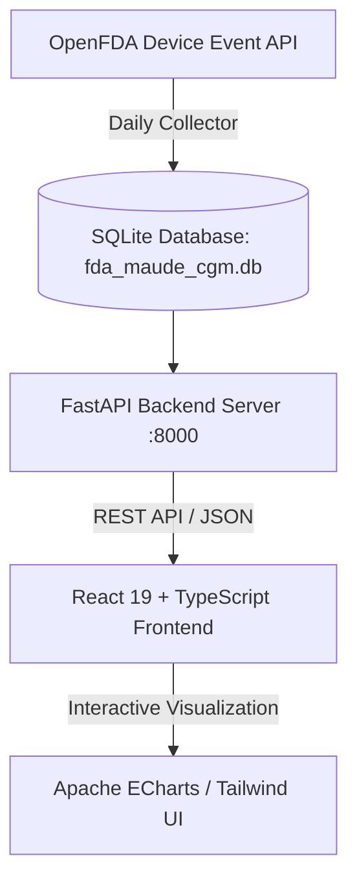

# System Architecture & Technical Specification

## 1. 시스템 개요 (System Overview)
본 플랫폼은 **397만 건 이상의 방대한 FDA MAUDE 의료기기 이상사례(MDR) 데이터**를 밀리초(ms) 단위로 즉각 조회, 집계, 시각화할 수 있도록 설계된 차세대 고성능 웹 플랫폼입니다.

---

## 2. 데이터베이스 설계 (Database Architecture)

데이터베이스는 대용량 조회 성능과 디스크 효율성을 극대화하기 위해 **이원화 테이블 구조(Dual-Table Pattern)** 및 **사전 집계 서머리 테이블**을 적용했습니다.

### ① `maude_reports` (메인 인덱스 테이블)
* **레코드 수**: 3,979,575건
* **주요 필드**: `report_number`, `mdr_report_key`, `event_type`, `date_received`, `brand_name`, `device_category`, `generic_name`, `manufacturer_name`, `product_code`, `patient_problems`, `product_problems`, `summary_complaint_kr`, `summary_response_kr`, `summary_conclusion_kr`
* **인덱스 최적화**:
  * `idx_reports_date_brand (date_received, brand_name)`
  * `idx_reports_event_type (event_type)`
  * `idx_reports_category (device_category)`
  * `idx_reports_key (mdr_report_key)`

### ② `maude_reports_text` (텍스트 분리 저장 테이블)
* 긴 원문 내러티브 필드(`event_description`, `manufacturer_narrative`, `additional_manufacturer_narrative`)를 별도 테이블로 분리하여 메인 테이블의 I/O 블록 크기를 획기적으로 축소.

### ③ `maude_reports_raw` (zlib 압축 원본 JSON)
* OpenFDA 원본 JSON을 `zlib`으로 압축하여 저장 (`raw_json_z`), 스토리지 사용량을 85% 이상 절감하면서 필요 시 무손실 복원.

### ④ `maude_reports_fts` (SQLite FTS5 전문 검색 가상 테이블)
* 전문 키워드(증상, 불만사항, 원문 서술 등)에 대한 초고속 텍스트 인덱싱 지원.

### ⑤ `maude_monthly_summary` (사전 집계 통계 테이블)
* `(year_month, brand_name, device_category, event_type, report_source_code)` 단위로 사전 집계하여 수백만 건의 시계열 차트 쿼리를 0.01초 내에 반환.

---

## 3. 대표 브랜드 그룹화 엔진 (Canonical Grouping Engine)

OpenFDA 데이터 특성상 수기 입력으로 인해 발생하는 1,728개의 파편화된 브랜드 명칭을 11대 대표 제품군으로 자동 매핑합니다:

### CGM 카테고리 (7개 대표 그룹)
1. **Dexcom G6**
2. **Dexcom G7**
3. **Dexcom G7 15 Day**
4. **FreeStyle Libre 2**
5. **FreeStyle Libre 2+**
6. **FreeStyle Libre 3**
7. **FreeStyle Libre 3+**

### 인슐린 펌프 카테고리 (4개 대표 그룹)
1. **Omnipod 5**
2. **Omnipod DASH**
3. **Medtronic MiniMed 780G**
4. **Tandem t:slim X2**

---

## 4. 백엔드 API 명세 (Backend API Specification)

| Method | Endpoint | 설명 |
| :--- | :--- | :--- |
| `GET` | `/api/metadata` | DB 전체 수집 건수, 카테고리별 브랜드 목록, 필터 메타데이터 조회 |
| `POST` | `/api/stats/overview` | 조건별 총합, 4대 부작용 비중, Top 10 제품 랭킹 통계 반환 |
| `POST` | `/api/stats/monthly-trend` | 월별/분기별/연도별 시계열 집계 데이터 및 점유율 반환 |
| `POST` | `/api/reports` | 조건별 MDR 보고서 페이징 조회, FTS5 전문 검색 |
| `GET` | `/api/reports/{report_number}` | 단일 MDR 보고서 상세 정보, 3단계 요약, Annex 코드, 원문 JSON 반환 |
| `POST` | `/api/stats/problem-codes` | IMDRF Annex E (환자 증상) 및 Annex A (기기 결함) 발생 빈도 통계 반환 |
| `POST` | `/api/stats/insights` | 중증 부작용 비교, FDA 보고 접수 경로 시계열, 이상 급증 탐지 반환 |
| `GET` | `/api/bookmarks` | 사용자 저장 북마크 및 폴더 목록 조회 |
| `POST` | `/api/bookmarks` | MDR 보고서 북마크 저장 / 태그 / 연구 메모 갱신 |
| `DELETE`| `/api/bookmarks/{report_number}` | 북마크 삭제 |
| `GET` | `/api/brand-groups` | 대표 브랜드 그룹 및 매핑 사전 조회 |
| `POST` | `/api/brand-groups` | 사용자 커스텀 브랜드 그룹 규칙 저장 및 반영 |

---

## 5. 프론트엔드 아키텍처 (Frontend Architecture)

* **상태 관리**:
  * `stagedFilters` (사이드바 입력 임시 상태) vs `appliedFilters` (실제 서버 쿼리 적용 상태) 분리를 통해 대용량 쿼리 부하 최소화 및 사용자 검색 통제권 확보.
* **차트 컴포넌트**:
  * Apache ECharts 기반 반응형 렌더링.
  * 마우스 드래그 핸들을 통한 실시간 높이 리사이징 (`OverviewTab`).
  * 선형(Linear) 및 로그(Logarithmic) 스케일 전환 지원.
* **디자인 시스템**:
  * Tailwind CSS 다크 모드 테마, 글래스모피즘(Glassmorphism) 카드, 부드러운 마이크로 인터랙션.
